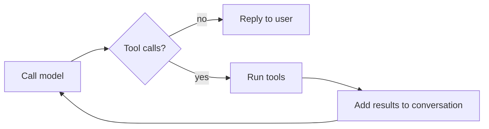

# digital-twin

A digital version of me, professionally at least.

This is an AI agent built **without any agentic framework**: just plain Python, an OpenAI-compatible model API and a Gradio UI. Writing everything by hand is the point. It's a way to learn how an agent works under the hood and to put the core agentic AI concepts into practice. The project will stay framework-free in every future version.

## What it does

The agent knows about my career from my LinkedIn profile. Anyone, whether a prospective client, an employer or just someone curious, can chat with it to learn about my background, skills and experience.

Through the chat, it can also:

- **Record questions it can't answer**, so I can see what's missing and fill the gaps.
- **Record contact details** (name and email) of anyone who wants to get in touch.

Both are stored in a private Hugging Face Dataset.

## How it works

### The agent loop

At its core, the agent is a loop. The model is called with the conversation and a set of tools it may use. If it asks for tools, the app runs them, sends the results back and calls the model again. When it replies without asking for tools, that reply goes to the user.



The model, not the code, decides when the loop ends. Because of that, the code around the model doesn't blindly trust either the model or the UI:

- **Bounded loop.** Each message allows only a limited number of tool rounds (`MAX_TOOL_ROUNDS`). Once that budget is used up, the model is called one last time with tools disabled, so it has to answer with what it already knows. If a reply still comes back empty, a short fallback message is shown.
- **Tool errors are fed back, not raised.** Tool arguments are generated by the model and can be wrong: invalid JSON, wrong fields, or a tool that doesn't exist. Tools can also fail on their own. Instead of crashing, every failure is returned to the model as an error result, so it can correct itself or tell the user. Every tool call always gets a matching result, which the API requires.
- **UI history is translated for the model.** Gradio stores chat history in its own format, with extra fields and rich content. That history is converted to plain role/content text messages before being sent to the model, so the agent works with any OpenAI-compatible provider.
- **No personal data in logs.** Logs record which tool ran and whether it failed, never the arguments (which may contain names and emails).

### Data storage

Contact details and unanswered questions are written to a **private Hugging Face Dataset**. A Space's disk is wiped whenever it restarts, so nothing can be kept locally for long.

- Records are appended to local [JSON Lines](https://jsonlines.org/) files, and a background uploader (`huggingface_hub`'s `CommitScheduler`) pushes any changes to the dataset every minute. Writing to the chat stays fast, and the dataset doesn't get one commit per record.
- Each app run writes to its own files (`contacts/<run-id>.jsonl`, `questions/<run-id>.jsonl`). A restarted Space starts with an empty folder, so reusing a file name would overwrite what's already on the Hub.
- The app refuses to write if the dataset is public, and it caps the length of every stored field.
- Storage is only set up the first time it's needed. Without it, the chat still works, and the agent tells the visitor it couldn't save their details.

To read the data:

```python
from datasets import load_dataset

contacts = load_dataset("<user>/<dataset>", data_files="contacts/*.jsonl", split="train")
```

### Project layout

| File | Purpose |
|---|---|
| `src/digital_twin/app.py` | Gradio app and the agent loop |
| `src/digital_twin/context.py` | Builds the system prompt from the LinkedIn profile |
| `src/digital_twin/tools.py` | Tool functions, their JSON schemas and the tool-call handler |
| `src/digital_twin/styles.py` | UI theme and example prompts |
| `src/digital_twin/files/` | Source documents (LinkedIn profile PDF) |

## Running locally

Requires Python 3.12+ and [uv](https://docs.astral.sh/uv/).

1. Create a `.env` file in the repo root with:

   | Variable | Description |
   |---|---|
   | `MODEL_NAME` | Model to use |
   | `BASE_URL` | Base URL of the OpenAI-compatible API |
   | `MODEL_API_KEY` | API key for that provider |
   | `MAX_TOOL_ROUNDS` | Optional; maximum tool rounds per message (default `5`) |
   | `HF_DATASET_REPO` | Dataset for stored records, e.g. `<user>/digital-twin-data`; it's created as private if it doesn't exist |
   | `HF_TOKEN` | Hugging Face access token with write access to that dataset (a fine-grained token scoped to that one repo is best) |

2. Run:

   ```bash
   uv run python src/digital_twin/app.py
   ```

On Hugging Face Spaces, set the same values as Space variables and secrets instead of using a `.env` file.

## Roadmap

- More data sources beyond LinkedIn, possibly through a RAG pipeline.
- More tools and features, still without an agentic framework.

## Changelog

The format is based on [Keep a Changelog](https://keepachangelog.com/en/1.1.0/),
and this project adheres to [Semantic Versioning](https://semver.org/spec/v2.0.0.html).

### [Unreleased]

#### Added
- Limit on tool rounds per message, configurable with `MAX_TOOL_ROUNDS`, with a final tool-free answer when the limit is reached.
- Tool errors (invalid arguments, unknown tools, failing tools) are returned to the model instead of crashing the app.
- Gradio chat history is converted to plain text messages before being sent to the model.
- Contact details and unanswered questions are stored in a private Hugging Face Dataset.
- A privacy notice in the chat UI explaining what's stored and why.

#### Changed
- The system prompt is built from the LinkedIn profile only (`summary.txt` removed).
- File paths are resolved relative to the source files, so the app can be started from any folder.

#### Removed
- Unused dependencies: `openai-agents`, `pydantic-ai-slim`, `ipykernel`, `ipywidgets`, `plotly`, `requests`.

### [0.1.0] - 2026-11-04

#### Added
- First version: Gradio chat app, a LinkedIn-based system prompt, and stub tools for recording questions and contact details.
