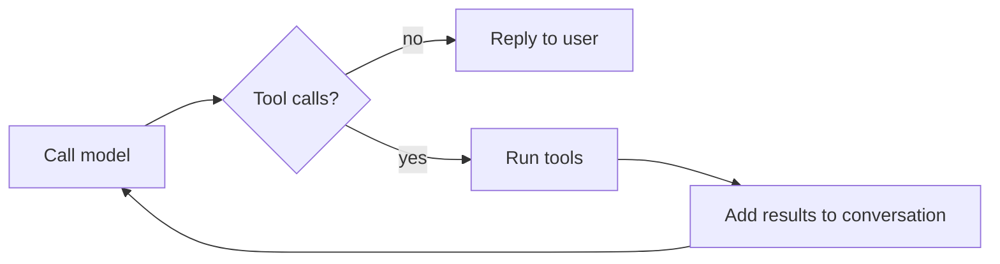

# digital-twin

A digital version of me, professionally at least. Try talking with it [here](https://digital-twin-5n17.onrender.com)!

This is an AI agent built **without any agentic framework**: just plain Python, an OpenAI-compatible model API and a Gradio UI. Writing everything by hand is the point. It's a way to learn how an agent works under the hood and to put the core agentic AI concepts into practice. The project will stay framework-free in every future version.

## What it does

The agent knows about my career from my LinkedIn profile. Anyone, whether a prospective client, an employer or just someone curious, can chat with it to learn about my background, skills and experience.

Through the chat, it can also:

- **Record questions it can't answer**, so I can see what's missing and fill the gaps.
- **Record contact details** (name and email) of anyone who wants to get in touch.

Both are stored in a private Hugging Face Dataset. You can ask the twin to have your details deleted at any time.

## How it works

At its core, the agent is a loop: it sends the conversation to the model, and if the model asks to use a tool (such as saving your email), the app runs it and asks the model again, until the model has a reply for you.



The code around the model doesn't blindly trust it: the loop has a fixed number of rounds, tool errors are handed back to the model instead of crashing the app, and no personal data ends up in the logs.

More detail: [Architecture](docs/architecture.md).

## Keeping it safe and affordable

The twin is public and every message costs money, so it has a few guard rails:

- **Fair use.** Each visitor can send a limited number of messages per minute, and very long messages are turned away.
- **A daily budget.** Once the day's budget is used up, the twin takes a rest until tomorrow.
- **Careful with your data.** Contact details are checked before they're saved, duplicates are ignored, and only a few can be saved per visitor.
- **Hard to trick.** The twin is told to keep its instructions private and to stay in character, whatever a visitor claims.

More detail, including every setting: [Protections](docs/protections.md).

## Limitations

- As of 04 Nov 2026, the twin runs on `gemini-3.5-flash-lite` to keep costs down, so replies can be slow. I'll improve this as time and budget allow.
- The twin is hosted on [Render](https://render.com). Since 09 July 2026, Hugging Face Spaces needs a PRO account to host a Gradio app, so I moved it to keep costs minimal.

## Running it yourself

You'll need Python 3.12+, [uv](https://docs.astral.sh/uv/), an API key for an OpenAI-compatible model, and a Hugging Face account for storage. Once your settings are in a `.env` file ([Development](docs/development.md) lists them, and covers testing), start it with:

```bash
uv run python app.py
```

## Roadmap

- More data sources beyond LinkedIn, possibly through a RAG pipeline.
- More tools and features, still without an agentic framework.

## Changelog

See [CHANGELOG.md](CHANGELOG.md).
