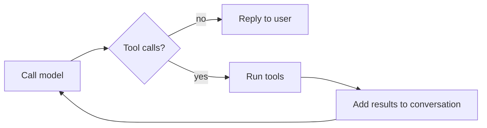

# Architecture

How the digital twin works under the hood. For what it does, see the [README](../README.md).

## The agent loop

At its core, the agent is a loop. The model is called with the conversation and a set of tools it may use. If it asks for tools, the app runs them, sends the results back and calls the model again. When it replies without asking for tools, that reply goes to the user.

The model, not the code, decides when the loop ends. Because of that, the code around the model doesn't blindly trust either the model or the UI:

- **Bounded loop.** Each message allows only a limited number of tool rounds (`MAX_TOOL_ROUNDS`). Once that budget is used up, the model is called one last time with tools disabled, so it has to answer with what it already knows. If a reply still comes back empty, a short fallback message is shown.
- **Tool errors are fed back, not raised.** Tool arguments are generated by the model and can be wrong: invalid JSON, wrong fields, or a tool that doesn't exist. Tools can also fail on their own. Instead of crashing, every failure is returned to the model as an error result, so it can correct itself or tell the user. Every tool call always gets a matching result, which the API requires.
- **UI history is translated for the model.** Gradio stores chat history in its own format, with extra fields and rich content. That history is converted to plain role/content text messages before being sent to the model, so the agent works with any OpenAI-compatible provider. It's also untrusted, since the browser sends it; see [Protections](protections.md).
- **No personal data in logs.** Logs record event names, which tool ran and whether it failed, never message content or tool arguments (which may contain names and emails).

## Code layout

| Path | What it does |
|---|---|
| `app.py` | Gradio UI and the chat handler: runs the checks, then the agent loop |
| `digital_twin/context.py` | Builds the system prompt from the LinkedIn profile |
| `digital_twin/tools.py` | The two write tools and their storage |
| `digital_twin/config.py` | Every configurable limit, with safe defaults |
| `digital_twin/guards.py` | Message validation and chat-history clean-up |
| `digital_twin/ratelimit.py` | Visitor identification and the per-visitor rate limit |
| `digital_twin/spend.py` | Daily model-call budget and circuit breaker |
| `digital_twin/toolguards.py` | Validation, caps and duplicate detection for the write tools |
| `scripts/check_client_ip.py` | Post-deploy check of visitor identification |
| `tests/` | Test suite, including adversarial cases |

## Data storage

Contact details and unanswered questions are written to a **private Hugging Face Dataset**. The app runs on [Render](https://render.com), whose disk is wiped whenever the server restarts, so nothing can be kept locally for long.

- Records are appended to local [JSON Lines](https://jsonlines.org/) files, and a background uploader (`huggingface_hub`'s `CommitScheduler`) pushes any changes to the dataset every minute. Writing to the chat stays fast, and the dataset doesn't get one commit per record.
- Each run writes to its own files, so a restart never overwrites records already uploaded.
- The app refuses to write if the dataset is public, and every stored field is validated and length-capped (see [Protections](protections.md#the-write-tools)).
- Storage is only set up the first time it's needed. Without it, the chat still works, and the agent tells the visitor it couldn't save their details.
